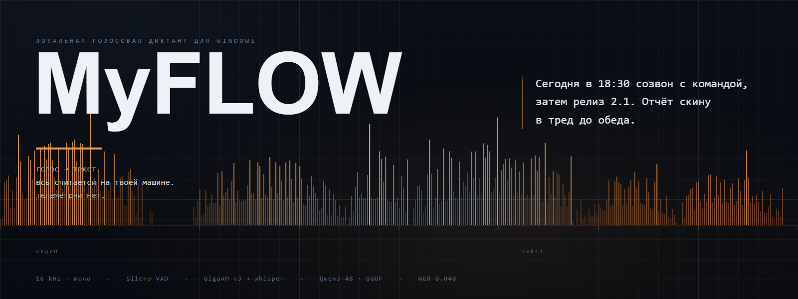
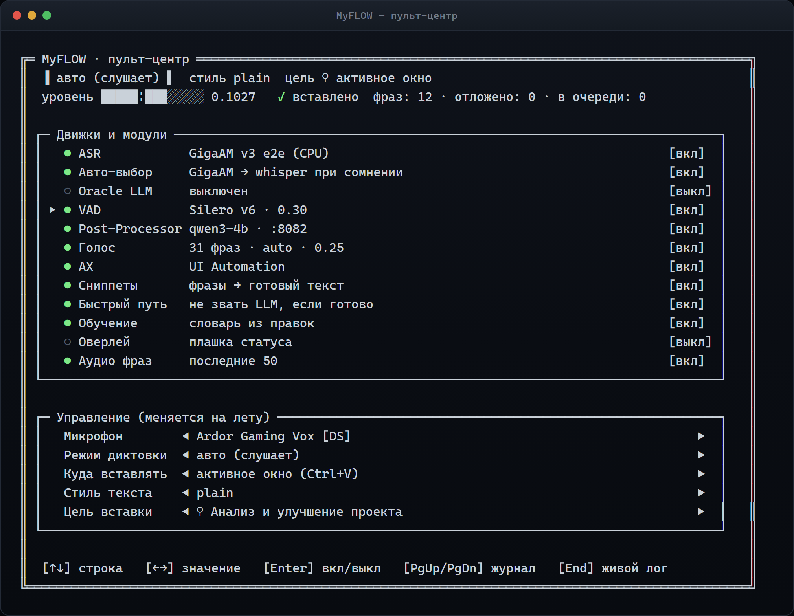
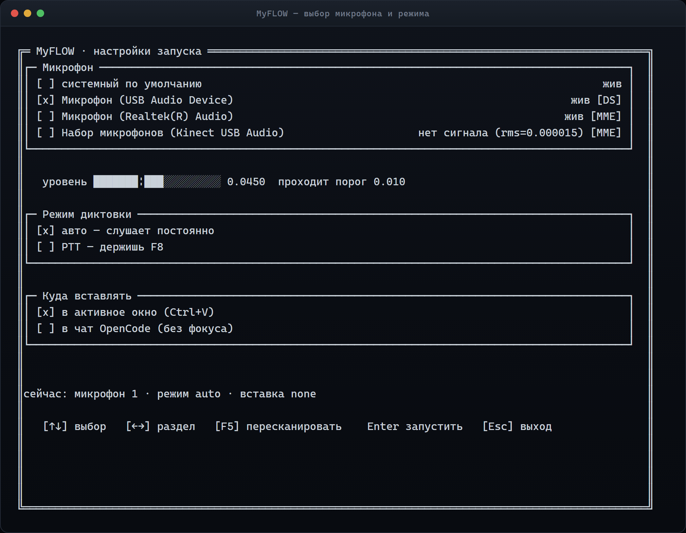
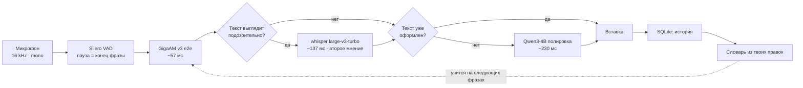
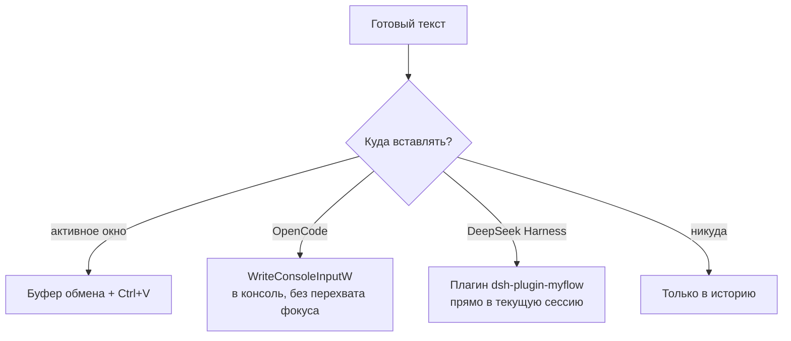

# MyFLOW

**Локальный голосовой диктант для Windows.** Говоришь — текст появляется там, где стоит курсор. Распознавание и полировка идут на твоей машине: голос никуда не уходит, телеметрии нет.

> [!TIP]
> **Впервые здесь?** Начни с [быстрого старта](QUICKSTART.md) — пошагово до первой диктовки. Полное руководство с замерами, схемами и настройками — ниже на этой странице.

| Метрика | Значение |
|---|---|
| Задержка «речь → вставка» | **719–750 мс** |
| WER p50 (авто-выбор движка) | **0.071** |
| Точных совпадений с эталоном | **44.7 %** |
| Тестов в репозитории | **789** |

---

## Что это

Клон архитектуры [Wispr Flow](https://goodsnooze.gumroad.com/l/wispr-flow), но целиком на твоём компьютере. Вместо облака — локальные модели: Whisper и GigaAM распознают речь, Qwen3-4B расставляет знаки препинания и приводит текст к нужному стилю.

На тех же 624 фразах Wispr Flow отдаёт распознанный текст за **421 мс** в медиане, MyFLOW — за **67 мс**: движок GigaAM успевает быстрее, а второй движок подключается только когда результат выглядит подозрительно. Полный цикл «речь → вставка» — **719–750 мс**, включая полировку локальной LLM.

Три вещи, которых нет у облачных аналогов:

- **Приватность.** Голос не покидает машину. Нет аккаунта, нет подписки, нет телеметрии — ни Sentry, ни PostHog.
- **Обучение под тебя.** Правки, которые ты вносишь в распознанный текст, попадают в личный словарь: проект запоминает твои имена, термины и любимые формулировки.
- **Полный контроль.** Все движки, стили, цели вставки и пороги VAD — на панели и в конфиге, а не за флагом в чужом SaaS.

## Скриншот

Всё управление — один TUI-пульт в консоли. Он сам поднимает серверы, показывает состояние и принимает команды на лету.



<details>
<summary>Экран настроек</summary>



</details>

## Как устроено



Ключевые решения, из-за которых это быстро:

- **Два движка, а не один.** GigaAM отдаёт результат за 57 мс, но на сложных фразах ошибается. Он же проверяет свой же результат: обрывок в конце, нет конечной пунктуации, низкий темп речи — признаки, что фраза распозналась плохо. Тогда подключается whisper как второе мнение. Срабатывает примерно в 20 % случаев, и именно там качество прыгает с WER 0.229 до 0.188.
- **Быстрый путь.** Если GigaAM уже вернул оформленный текст (есть пунктуация, заглавная, нет чисел словами) — LLM не зовётся вообще. Так проходят **431 фраза из 624 (69 %)**; для стиля `plain` — 84 %. Скорость: p50 104 мс вместо 982 мс.
- **Ничего не остаётся в памяти.** При выходе TUI гасит поднятые им серверы: освобождаются RAM и VRAM. Модель LLM выгружается по `F11`, если нужен весь видеопамяти.

Подробный разбор с цифрами — в [инженерных заметках](docs/ENGINEERING-NOTES.md).

## Возможности

| Что | Как |
|---|---|
| Два режима диктовки | **PTT** (держишь `F8`) или **авто** (слушает всегда, режет по паузе) |
| Пять стилей текста | `plain`, `casual`, `formal`, `terminal`, `summarize` — переключаются на лету |
| Четыре цели вставки | активное окно, консоль OpenCode, чат DeepSeek Harness, «только история» |
| Голосовые команды | «стоп», «скип», «перескажи», «список», «удали последнее», «новый абзац», «отправь» |
| Личный словарь | учится на твоих правках, отдельно для каждого приложения |
| Проверка голоса | отсекает чужую речь (телевизор, коллеги) по speaker verification |
| Дообучение | твой постпроцессор обучается на свежих диктовках, новая модель ставится только если она не хуже текущей |
| Интеграция с DSH | плагин ставится в DeepSeek Harness автоматически, диктовка идёт прямо в чат |

## Установка

### Что нужно

| | |
|---|---|
| ОС | Windows 10/11 (64-бит) |
| Python | **3.13** — батник `install-myflow.bat` создаёт `.venv` именно на 3.13. Окружение руками можно создать на любой установленной версии (`py -3 -m venv .venv`), MyFLOW работает на 3.11+. [python.org](https://www.python.org/downloads/), при установке поставь галочку «Add python.exe to PATH» |
| Место на диске | ~7 ГБ: модели (~1.2 ГБ) + бинарники серверов (~1.7 ГБ) + LLM (~4 ГБ) |
| Видеокарта | **не обязательна** — на CPU всё работает, просто медленнее. С NVIDIA-картой быстрее в разы |
| Микрофон | любой, есть выбор в панели |

### Шаг 1. Код

```powershell
git clone https://github.com/fakingpescobar-ctrl/MyFLOW.git
cd MyFLOW
```

### Шаг 2. Окружение и зависимости

Двойной клик по **`install-myflow.bat`** — скрипт проверит Python, создаст `.venv`, поставит зависимости из `requirements.txt` и запустит доктора.

Или руками:

```powershell
py -3 -m venv .venv
.venv\Scripts\python -m pip install --upgrade pip
.venv\Scripts\pip install -r requirements.txt
```

`requirements.txt` покрывает только ядро. Три пакета в нём закомментированы, но без них половина заявленного не работает — поставь их отдельно:

```powershell
.venv\Scripts\pip install soundfile "onnx-asr[hub]" kaldi_native_fbank
```

| Пакет | Что даёт |
|---|---|
| `onnx-asr[hub]` | бэкенд **GigaAM** — основной движок распознавания (57 мс). Без него `asr.backend=auto` уходит в whisper, и быстрый путь со вторым мнением выключаются |
| `kaldi_native_fbank` | **проверка голоса** — отсекает чужую речь (телевизор, коллеги) |
| `soundfile` | чтение и запись аудио; без него доктор никогда не напишет «ВСЁ ГОТОВО ✓» |

### Шаг 3. Модели

**Их можно не качать вручную.** При первом запуске MyFLOW сам проверит, чего не хватает, покажет список и предложит скачать — после твоего «да» (см. [«Приложение чинит себя само»](#приложение-чинит-себя-само)).

Если хочешь скачать заранее:

```powershell
.venv\Scripts\python -X utf8 -m myflow.bootstrap --fix
```

Что при этом качается:

| Файл | Размер | Куда | Откуда |
|---|---|---|---|
| whisper large-v3-turbo | 547 МБ | `models\` | [ggerganov/whisper.cpp](https://huggingface.co/ggerganov/whisper.cpp) |
| `Qwen3-4B-Instruct-2507-Q8_0.gguf` | 4.0 ГБ | `models\` | [unsloth/Qwen3-4B-Instruct-2507-GGUF](https://huggingface.co/unsloth/Qwen3-4B-Instruct-2507-GGUF) |
| `silero_v6.onnx` — VAD | 2.3 МБ | `data\vad_models\` | [snakers4/silero-vad](https://github.com/snakers4/silero-vad), файл `src/silero_vad/data/silero_vad.onnx` |
| `model.onnx` — проверка голоса | 25 МБ | `models\voiceprint\` | [onnx-community/wespeaker-voxceleb-resnet34-LM](https://huggingface.co/onnx-community/wespeaker-voxceleb-resnet34-LM), файл `onnx/model.onnx` |

> [!IMPORTANT]
> Без VAD-модели приложение **не запустится**: каталог `data/` в git не попадает. Поэтому она есть в списке на скачивание — пульт не даст стартовать, пока её нет.

GigaAM v3 e2e (214 МБ) подтягивается сам при первом распознавании — нужен интернет один раз.

**`fetch-models.bat`** по-прежнему качает whisper — можно запустить и его, докачка с прерыванием включена:

```powershell
fetch-models.bat
```

> [!NOTE]
> **Постпроцессор** — это собственная дообученная LoRA проекта (`models\myflow-postproc-*.gguf`, 424 МБ). На HuggingFace её нет и в git она не лежит — бери у автора. Без неё работает базовая модель выше: полировка выходит чуть грубее, всё остальное — как обычно.

### Шаг 4. Бинарники серверов

Эти два файла не качаются скриптом — их нужно взять из релизов и положить руками:

| Файл | Куда | Откуда |
|---|---|---|
| `llama-server.exe` (+ CUDA-dll) | `bin\llama-cpp\` | [релизы llama.cpp](https://github.com/ggml-org/llama.cpp/releases) |
| `whisper-server.exe` (+ CUDA-dll) | `bin\whisper\Release\` | [релизы whisper.cpp](https://github.com/ggml-org/whisper.cpp/releases) |

Без CUDA-сборки тоже работает — просто медленнее. Рекомендуемая сборка: **CUDA 12**.

### Шаг 5. Проверка

```powershell
.venv\Scripts\python -X utf8 tools\doctor.py
```

Доктор перечислит всё, чего не хватает, и скажет, что делать. Если написано «ВСЁ ГОТОВО ✓» — можно запускать.

Сказать доктору «докачай сам»:

```powershell
.venv\Scripts\python -X utf8 tools\doctor.py --fix
```

### Приложение чинит себя само

Перед стартом пульт проверяет, всё ли на месте — и пакеты, и модели. Если чего-то не хватает, приложение показывает список и спрашивает:

```
  MyFLOW — кое-чего не хватает:
  [ файл  ] data\vad_models\silero_v6.onnx — детектор речи — без него
           приложение не стартует, 2 МБ (обязателен)

  Поставить и скачать? [Y/n]
```

После «да» пакеты ставятся в то же окружение, из которого запущено MyFLOW, файлы качаются с докачкой и прогресс-баром. После «нет» приложение не молчит, а показывает точные команды, чтобы сделать руками.

Без согласия пользователя **ничего не скачивается и не ставится** — это правило модуля, а не вежливость.

Недостающее необязательное (например, проверка голоса) не мешает запуску: приложение спросит, но продолжит работать и без него.

### Шаг 6. Запуск

Двойной клик по **`start-myflow.bat`**. Откроется одно окно: сначала экран выбора микрофона и режима, потом живой пульт диктовки.

### Шаг 7. Диктовка

Поставь курсор в нужное окно, нажми `F8`, говори, отпусти. Текст вставится.

Положи окно в сторону и посмотри, как это выглядит без серверов:

```powershell
.venv\Scripts\python -X utf8 -m myflow.tui --demo
```

## Свой постпроцессор

Полировку делает **твой личный** постпроцессор: LoRA поверх Qwen3-0.6B, обученная на **твоих** правках. Он и быстрее, и точнее общей Qwen3-4B, и ест в десять раз меньше видеопамяти:

| Модель | WER p50 | WER среднее | Задержка p50 | VRAM |
|---|---|---|---|---|
| Qwen3-4B (общая) | 0.091 | 0.152 | 72 мс | ~5–6 ГБ |
| **свой 0.6B (на твоих правках)** | 0.091 | **0.139** | **64 мс** | **~0.6 ГБ** |

> [!IMPORTANT]
> Модель **не выкладывается** в репозиторий: она обучена на твоей речи и твоём словаре. Каждый обучает свою — в этом весь смысл: чужой постпроцессор тебе только мешал бы (навязывал бы чужие имена и привычки).

Как получить своего:

**1. Учебное окружение.** Отдельное: там CUDA-torch (~2.5 ГБ), в боевое `.venv` он не нужен.

```powershell
install-train-env.bat
```

**2. База и корпус.** Приложение предложит их само — но только если учебное окружение уже стоит (иначе незачем спрашивать).

```powershell
.venv\Scripts\python -X utf8 -m myflow.bootstrap --fix
```

Вручную — теми же командами, что зовёт приложение:

```powershell
python tools\fetch_hf_model.py Qwen/Qwen3-0.6B --dir data\train\Qwen3-0.6B
python tools\fetch_corpus.py --rows 3000
```

**3. Подиктуй.** Каждая диктовка с текстом — готовый размеченный пример «что услышали → что поправил». Нужно порядка сотни, чтобы обучение было осмысленным; пульт сам покажет, сколько накопилось.

**4. Обучи.** В пульте строка **«Дообучение» → Enter**, или руками:

```powershell
.venv\Scripts\python -X utf8 tools\retrain_postproc.py --dry-run   # план
.venv\Scripts\python -X utf8 tools\retrain_postproc.py             # полный цикл, ~20 мин
```

Новая модель ставится **только если она не хуже текущей** — проверка на отложенных фразах, иначе остаётся прежняя, а старая уходит в бэкап.

Без своего постпроцессора приложение работает на общей Qwen3-4B: качество ниже (WER 0.152 против 0.139), а видеопамяти нужно в десять раз больше. Лицензионно это чисто: база — Apache-2.0, веса — твои и лежат локально.

## Управление

### Горячие клавиши

| Клавиша | Действие |
|---|---|
| `F8` | push-to-talk: держишь — диктуешь |
| `F9` | отменить текущую диктовку |
| `F7` | следующий стиль текста (`plain → casual → formal → terminal → summarize`) |
| `F6` | закрепить текущее окно как цель вставки (или снять закрепление) |
| `F10` | вставить отложенное немедленно, не дожидаясь паузы |
| `F11` | выгрузить LLM из VRAM |

Клавиши можно переназначить в `data\settings.json`. Есть флаг `hotkey.suppress` — не отдавать эти клавиши активному окну (в IDE `F8` = шаг отладки).

### Клавиши пульта

| Клавиша | Действие |
|---|---|
| `↑` `↓` | выбрать строку |
| `←` `→` | изменить значение |
| `Enter` | включить/выключить модуль |
| `PgUp` `PgDn` | прокрутить журнал |
| `End` | живой лог |
| `r` | вернуться к настройкам |
| `s` | перезапустить упавший сервер |
| `c` | очистить журнал |
| `o` | вкл/выкл графическую плашку статуса |
| `q` | выйти (гасит серверы, которые поднял сам) |

## Куда вставляется



- **Активное окно** — обычный режим: копируем в буфер и шлём `Ctrl+V`. Нетекстовые форматы (картинки, файлы) не задеваются.
- **OpenCode** — текст уходит прямо в консоль, окно переключать не нужно.
- **DeepSeek Harness** — плагин ставится в установку DSH автоматически (в панели строка «Мост в DSH»), потом диктовка идёт прямо в чат.
- **Никуда** — фразы только в историю. Удобно, когда диктуешь в пустое поле и вставляешь потом сам.

## Голосовые команды

Слова распознаются как есть и выполняют действие:

| Слово | Что делает |
|---|---|
| «стоп» / «stop» | прекращает диктовку |
| «скип» / «skip» | пропускает текущую фразу |
| «удали последнее» | отменяет последнюю вставку |
| «новый абзац» | вставляет разделитель абзацев |
| «отправь» | `Enter` в окно, куда вставлялось |
| «перескажи» / «перепиши» | пересказ последней вставки |
| «сократи» | сокращает последнюю вставку (с аргументом — надиктованный текст) |
| «список» / «списком» | оформляет последнюю вставку списком |

С аргументом работают префиксы: «перескажи *этот параграф*», «сократи *текст*», «список *пунктов*». Свободная формулировка («кратко перескажи», «удали это») разбирается LLM-интентом — но вызов дороже, поэтому включается только на словах-маркерах.

> [!NOTE]
> Не всякая фраза с командным словом является командой. «Отправь это сообщение» остаётся **текстом** — «отправь» с аргументом намеренно не перехватывается. «Список продуктов» тоже остаётся текстом: есть защита от случайных перечислений. А «перескажи этот абзац», «сократи текст», «список пунктов» — настоящие команды с аргументом.

## Настройки

Всё лежит в `data\settings.json` и правится на лету из пульта. Ключевые ручки:

| Ключ | Смысл |
|---|---|
| `mode` | `ptt` (по кнопке) или `auto` (слушает постоянно) |
| `hotkey.ptt_key` / `cancel_key` / `style_cycle_key` | клавиши `F8` / `F9` / `F7` |
| `hotkey.suppress` | не отдавать эти клавиши активному окну |
| `insert_method` | `clipboard` (`Ctrl+V`) или `opencode` (инжект в консоль) |
| `silence_pause_seconds` | пауза, завершающая фразу (0.9 с) |
| `history_retention_days` | сколько дней хранить историю (`0` = вечно) |
| `flags.live_preview` / `learning` / `overlay` / `auto_insert` | фиче-флаги |
| `polish.top_p` / `repeat_penalty` / `max_tokens` | параметры полировки |
| `style_by_app` | маска окна/процесса → стиль (например `"code.exe": "terminal"`) |

Подробности — в [`myflow/config.py`](myflow/config.py).

### Переменные окружения

По умолчанию всё лежит внутри проекта — пути на другие диски не зашиты. Если нужно вынести, есть переменные:

| Переменная | По умолчанию | Что задаёт |
|---|---|---|
| `MYFLOW_MODELS_DIR` | `<проект>\models` | каталог моделей |
| `MYFLOW_LLAMA_DIR` | `<проект>\bin\llama-cpp` | каталог с `llama-server.exe` |
| `MYFLOW_WHISPER_DIR` | `<проект>\bin\whisper` | корень whisper.cpp; сам `whisper-server.exe` лежит в `Release\` внутри него |
| `MYFLOW_WHISPER_MODEL` | `<проект>\models\ggml-large-v3-turbo-q5_0.bin` | модель whisper |
| `HF_HOME` | `<проект>\models\hf-cache` | кэш GigaAM |
| `MYFLOW_VOICEPRINT_MODEL` | `<проект>\models\voiceprint\model.onnx` | модель проверки голоса |
| `MYFLOW_SILERO_PATH` | `data\vad_models\silero_v6.onnx` | модель VAD |

Самодостаточность проверяется тестом `tests/test_paths.py` — он падает, если ассет оказался вне проекта или в коде появился абсолютный путь с буквой диска.

## Замеры

Все цифры MyFLOW — на RTX 3080 10GB, на 624 реальных диктовках. Строка Wispr Flow — облачный замер.

### Задержка

| Шаг | Время |
|---|---|
| GigaAM v3 e2e (распознавание) | 57 мс |
| whisper large-v3-turbo (распознавание) | 137 мс |
| Полировка Qwen3-4B Q8 | 205 мс p50 / 259 мс p90 |
| Быстрый путь (без LLM) | 104 мс p50 |
| **e2e: речь → вставка** | **719–750 мс** |

### Точность

WER считается к эталонному тексту, «ё» приравнивается к «е»:

| Конфигурация | WER p50 | WER среднее | Точных совпадений | Задержка p50 |
|---|---|---|---|---|
| только GigaAM | 0.083 | 0.138 | 42.1 % | 57 мс |
| только whisper | 0.111 | 0.147 | 36.7 % | 137 мс |
| **авто-выбор (по умолчанию)** | **0.071** | **0.130** | **44.7 %** | **67 мс** |
| Oracle LLM (склейка двух) | 0.040 | 0.107 | 49.0 % | ~390 мс |
| Wispr Flow (облако) | — | — | — | 421 мс |

Oracle LLM — режим максимальной точности: прогоняются оба движка, LLM собирает из двух текстов один. Почти в шесть раз дороже авто-выбора движка (390 мс против 67 мс), поэтому выключен по умолчанию.

## Тесты

759 тестов на `unittest`, без внешних зависимостей — запускаются за 45 секунд.

```powershell
.venv\Scripts\python -X utf8 -m unittest discover -s tests -t .
```

> [!IMPORTANT]
> Флаг `-X utf8` нужен там, где вывод перехватывается — pipe, CI, плагин IDE. Тогда кодировка cp1251 не берёт символы `⚠` и `✗` в `print()`, и шесть тестов из 759 падают с `UnicodeEncodeError` на ровном месте. В обычном окне Windows-консоли Python 3.6+ и так пишет в UTF-8, так что руками можно запускать и без флага.

Тесты закрывают все P0/P1-баги из аудита: проброс горячих клавиш, отмена диктовки, защита вставки, обучение словаря, переключение движка, чистка потоков при закрытии, работа без серверов.

## Структура проекта

```
myflow/
  tui.py            # ОДНО окно: серверы + выбор настроек + пульт диктовки
  main.py           # оркестратор: хоткеи, очередь, пайплайн, отмена
  audio.py          # запись 16k mono, PTT/AUTO, автостоп по VAD, превью
  vad.py            # Silero v6 (ONNX, CPU) — стрим с hidden-state
  asr.py            # клиент whisper-server (Session + Retry, WAV в памяти)
  asr_router.py     # авто-выбор движка: признаки «подозрительного» текста
  asr_gigaam.py     # бэкенд GigaAM v3 e2e (ONNX, CPU)
  asr_judge.py      # склейка двух распознаваний (Oracle LLM)
  fastpath.py       # пропуск LLM, если текст уже оформлен
  polish.py         # клиент llama-server: стили, правила, защита от инъекций
  commands.py       # голосовые команды: точные/префиксы/LLM-интент
  learning.py       # авто-обучение словаря из правок
  db.py             # SQLite: history / dictionary / settings_kv (WAL)
  insertion.py      # вставка через буфер + SendInput Ctrl+V
  opencode_inject.py # инжект в консоль OpenCode (WriteConsoleInputW)
  dsh_bridge.py     # мост в DeepSeek Harness
  overlay.py        # статус-плашка (тёмный бейдж, click-through)
  pick_mic.py       # TUI выбора микрофона/режима/цели
  config.py         # настройки (data/settings.json) и фиче-флаги
  cli.py            # CLI: сниппеты, словарь, статистика, retry, doctor
  bootstrap.py      # самопочинка: чего не хватает и предложение это скачать
scripts/            # start-asr / start-llm / start-all / stop-servers
tools/              # бенчи, eval, дообучение, доктор, ручные инструменты
tests/              # 789 тестов
data/               # рантайм: settings.json, myflow.sqlite, логи
models/             # модели (в git не попадают)
bin/                # llama-server / whisper-server (в git не попадают)
```

## Ограничения — честно

- **Видеопамять 10 ГБ** — это одна LLM плюс whisper. Две LLM одновременно не влезают, а оффлоад убивает скорость.
- **Контекст LLM — 8192 токена.** Системный промпт (~1.5–2к) плюс диктовка плюс ответ должны влезать; на 2048 в логе были реальные 400 `exceed_context_size`.
- **Авто-обучение ловит правки только если они скопированы в буфер** (выделение + `Ctrl+C`) в окне 6 секунд после вставки. Правки мышью без копирования не видны, правки в разных окнах не складываются.
- **Голосовые команды цепляют обычную речь.** «Перескажи этот абзац» — команда, даже если ты просто продиктовал эти слова. «Отправь X» — наоборот, никогда не перехватывается.
- **Вставка через буфер** может конфликтовать с чужой вставкой. Restore-логика есть, и она не трогает нетекстовые форматы.
- **Хоткеи требуют прав.** При фокусе на elevated-окне Windows (UIPI) хук или вставка могут не сработать.
- **Логи `data\main.log` содержат распознанный текст.** Не выкладывай их; каталог `data/` исключён из git.
- **Живое превью не ускоряет финальную вставку** — полная транскрипция всё равно считается в конце фразы. Это отклик во время длинных диктовок.

## Документы

| Файл | Что внутри |
|---|---|
| [QUICKSTART.md](QUICKSTART.md) | короткий путь: пошагово до первой диктовки |
| [docs/ENGINEERING-NOTES.md](docs/ENGINEERING-NOTES.md) | инженерный журнал: архитектура, замеры, все починки по датам |
| [AUDIT.md](AUDIT.md) | аудит проекта: находки с приоритетами, планы работ, доказательства |
| [THIRD_PARTY_LICENSES.md](THIRD_PARTY_LICENSES.md) | лицензии всех внешних компонентов |

## Статус проекта

- Лицензия проекта пока не выбрана — компоненты перечислены в [THIRD_PARTY_LICENSES.md](THIRD_PARTY_LICENSES.md).
- Скриншоты в этом README — реальные кадры TUI, снятые в демо-режиме (`--demo`), не мокапы.
- В репозитории лежат только код и документация: модели, бинарники, база и логи исключены из git.
